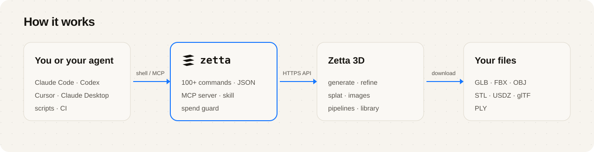
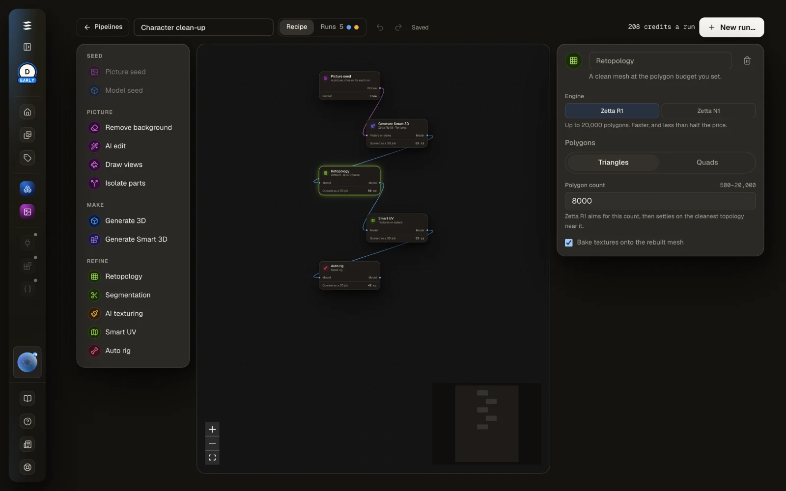

<p align="center">
  <picture>
    <source media="(prefers-color-scheme: dark)" srcset="docs/assets/banner-dark.svg">
    
  </picture>
</p>

<p align="center">
  <a href="docs/installation.md"></a>
  <a href="docs/installation.md"></a>
  <a href="docs/ai-agents.md"></a>
  <a href="docs/ai-agents.md"></a>
  <a href="docs/COMMANDS.md"></a>
</p>

<p align="center">
  <a href="#install"><b>Install</b></a> ·
  <a href="docs/getting-started.md"><b>Getting started</b></a> ·
  <a href="docs/ai-agents.md"><b>AI agents &amp; MCP</b></a> ·
  <a href="docs/COMMANDS.md"><b>Commands</b></a> ·
  <a href="docs/README.md"><b>Docs</b></a> ·
  <a href="https://zetta3d.ai"><b>zetta3d.ai</b></a>
</p>

<br>

`zetta` puts your whole [Zetta 3D](https://zetta3d.ai) account in the terminal. Use it to:
- make 3D models from text, a picture or several views;
- refine them: retopology, segmentation, UVs, texturing, rigging and format conversion;
- make and edit pictures, build Gaussian-splat worlds, and run multi-step pipelines;
- download or export the results.

It is built first for AI agents, and works just as well by hand:
- JSON output whenever it is piped, and one error format;
- exit codes you can branch on;
- an MCP server, and a skill file;
- a spend guard, so nothing costs credits by accident.

```bash
curl -fsSL https://zetta3d.ai/install.sh | sh
zetta auth login
zetta generate --image chair.png --engine n2.5 --max-credits 100 --out ./models
```

<p align="center">
  
</p>

<p align="center">
  <picture>
    <source media="(prefers-color-scheme: dark)" srcset="docs/assets/how-it-works-dark.svg">
    
  </picture>
</p>

---

- [Install](#install)
- [Sign in](#sign-in)
- [Quick start](#quick-start)
- [How it works](#how-it-works)
- [Use it from AI agents](#use-it-from-ai-agents)
- [Pipelines](#pipelines)
- [Configuration](#configuration)
- [Documentation](#documentation)
- [Development](#development)

## Install

One command. Nothing else needs to be installed first: no Node, no Python, no package manager.

**macOS and Linux**

```bash
curl -fsSL https://zetta3d.ai/install.sh | sh
```

**Windows (PowerShell)**

```powershell
irm https://zetta3d.ai/install.ps1 | iex
```

What the installer does:
- picks the build for your system (macOS, Linux including Alpine, Windows; x64 or arm64);
- checks its SHA-256 checksum;
- installs it to `~/.zetta/bin` (Windows: `%LOCALAPPDATA%\zetta\bin`), without sudo;
- adds that folder to your `PATH`.

Run it again, or run `zetta upgrade`, to update.

**Other ways to install** (available from the first public release):
- **npm** (needs Node 18+): `npm install -g @zetta3d/cli`, or `npx @zetta3d/cli --help`.
- **Homebrew:** `brew install zetta3d/tap/zetta`.

Check the installation:

```bash
zetta --version
zetta doctor
```

More detail — pinned versions, CI, uninstalling, Alpine — is in [docs/installation.md](docs/installation.md).

## Sign in

```bash
zetta auth login                          # opens zetta3d.ai in your browser; click Connect
```

| Where you are | How to sign in |
|---|---|
| A laptop with a browser | `zetta auth login` |
| SSH, a container, no browser | `zetta auth login --email you@example.com` — paste the link from the email (copy it; don't click it) |
| CI, scripts, agents | Set `ZETTA_TOKEN`. Copy the value with `zetta auth token` on a machine where you are signed in |

Where the token is kept:
- **Storage:** in the system keychain (macOS Keychain, Windows Credential Manager or libsecret). Where there is none, it goes in a `0600` file instead.
- **Check it:** `zetta auth status` shows who you are and when the token expires.
- **Treat it like a password.** Tokens last 30 days and cannot be revoked yet.

See [docs/authentication.md](docs/authentication.md).

## Quick start

```bash
# What do I have?
zetta account credits                     # 3D credits (1 credit = €0.01) and AI tokens
zetta catalog entitlements                # what your plan allows
zetta catalog engines                     # engines and their limits

# A model from a picture: price it, then make it and download it
zetta generate --image chair.png --engine n2.5 --dry-run
zetta generate --image chair.png --engine n2.5 --max-credits 100 --out ./models

# A model from text
zetta generate -p "a stylised wooden treasure chest" --quality lowpoly --yes --wait

# Your library
zetta asset list
zetta asset download 1234 --format glb --out ./models

# Finishing tools
zetta refine retopo 1234 --faces 5000 --yes --wait
zetta refine rig 1235 --rig-type biped --rig-format fbx --yes --out ./models

# Free local conversion
zetta asset export 1234 --format stl --out ./print

# Pictures
zetta image generate -p "a brass desk lamp, studio light" --for-3d --out ./refs
```

The full walkthrough is in [docs/getting-started.md](docs/getting-started.md), and every command is in [docs/COMMANDS.md](docs/COMMANDS.md).

## How it works

**Assets.** Every model you make, refine or import is an *asset* in your library. Each has a numeric id, a status (`queued`, `processing`, `success`, `failed`, …) and result files (GLB, FBX, OBJ, USDZ, PLY, …).

**Engines.** These are Zetta's models:

| Engine | What it is for | Plans |
|---|---|---|
| `n1` | Text, a picture or several views to 3D | All |
| `n2.5` | Picture or several views to 3D; parts, quads, Ultra detail | Paid |
| `np1`, `np1.5` | Smart 3D; up to 8K textures | Paid |
| `r1` | Retopology | Paid |
| `splat`, `splat2`, `splat2.1` | Gaussian-splat objects and worlds | Early access |

`zetta catalog engines` lists what each one supports.

**Credits and the spend guard.** Paid commands always check the price first.
- `--dry-run` shows the price and spends nothing.
- `--max-credits N` spends only if the price is at most N.
- `--yes` spends without asking.
- In a terminal without either flag, you are asked. Without a terminal, the command refuses and exits with code 5. Nothing is ever spent by accident.

Failed jobs are refunded automatically.

**Jobs run on the server.** In a terminal, `zetta` waits for each job and downloads the results into the folder you ran it in. Scripts and agents get the asset id at once instead.
- `--out <folder>` waits, then downloads the files there;
- `--no-download` (or `zetta config set download.auto false`) returns at once with the asset id;
- `zetta asset wait <id>` picks up waiting later.

If you set `--timeout`, the command exits with code 10 when that time runs out. The job keeps running.

**Inputs.** Wherever a picture is expected you can give:
- a local file (PNG, JPEG or WebP, 128–5000 px, up to 8 MB);
- an `https://` URL;
- `image:<id>`, a picture from your image library.

Models can be an asset id, a local `.glb` file, or a URL. The CLI uploads local files for you.

## Use it from AI agents

`zetta` was designed for agents such as Claude Code, Codex, Cursor and CI scripts.

**Contract:**
- **Output:** stdout is JSON whenever it is not a terminal; diagnostics go to stderr.
- **Errors:** always `{"error":{"code","message","details","hint","exitCode"}}`. The `hint` names the next command to run.
- **Exit codes:** 0 ok · 2 fix the input · 3 sign in · 4 plan does not allow it · 5 credits or spend limit · 6 not found · 7 conflict · 8 rate limited · 9 job failed · 10 still running · 11 network or server.
- **Self-describing:** `zetta commands --json` lists every command and flag, and `zetta schema <command>` gives its JSON Schema. `--input '<json>'` passes all of a command's inputs as one JSON object.
- **Safe retries:** `--idempotency-key <key>` makes a retry free of double charges.

**Connect your tool in one command:**

```bash
zetta setup claude-code --budget 500      # skill + MCP server for Claude Code
zetta setup claude-desktop                # MCP server for Claude Desktop
zetta setup cursor                        # MCP server for Cursor
zetta setup codex                         # MCP server + guide for Codex
zetta setup agents-md                     # guide in ./AGENTS.md for any agent
zetta skill install                       # just the skill (~/.claude/skills/zetta3d)
```

**MCP:** `zetta mcp` serves every command as an MCP tool, with the same checks.
- `--budget N` caps what a session may spend.
- `--read-only` offers only tools that never change anything.

The full agent guide is printed by `zetta guide`, and lives in [docs/ai-agents.md](docs/ai-agents.md) and [skill/SKILL.md](skill/SKILL.md).

## Pipelines

Pipelines are multi-step recipes, for example: picture → remove background → model → retopology → rig. They are the same pipelines as in the web editor, so a recipe built in either place opens in the other. From the terminal you write them as YAML, validate and price them, then run them over a whole folder.

```bash
zetta pipeline validate recipe.yaml && zetta pipeline create --file recipe.yaml
zetta pipeline batch 12 ./photos --max-credits 3000      # one run per picture
zetta run wait 88 --out ./out                            # collect every model
```

<p align="center">
  
</p>

See [docs/pipelines.md](docs/pipelines.md).

## Configuration

```bash
zetta config list
zetta config set spend.maxPerCommand 200   # agents may spend up to 200 credits per command
zetta config set download.auto false      # don't download finished jobs into the current folder
zetta config set download.dir models      # …or collect them in ./models
zetta config set output json               # always JSON
zetta --profile local asset list           # built-in profile for a local backend
zetta config add-profile staging --api https://staging-api.example.com/api --site https://staging.example.com
```

**Environment variables:**
- `ZETTA_TOKEN`, `ZETTA_PROFILE`, `ZETTA_API_URL`, `ZETTA_SITE_URL`
- `ZETTA_OUTPUT`, `ZETTA_CONFIG_DIR`
- `ZETTA_NO_KEYCHAIN=1`, `ZETTA_NON_INTERACTIVE=1`, `ZETTA_NO_UPDATE_CHECK=1`
- `NO_COLOR`

See [docs/configuration.md](docs/configuration.md).

## Documentation

| Guide | What is in it |
|---|---|
| [Installation](docs/installation.md) | Every install method, updating, uninstalling, CI, Alpine and old CPUs |
| [Getting started](docs/getting-started.md) | From sign-in to a downloaded model, step by step |
| [Authentication](docs/authentication.md) | Sign-in methods, tokens, keychain, profiles, CI |
| [Generating models](docs/generating.md) | Text, picture and multi-view to 3D, every option, splat worlds |
| [Refining models](docs/refining.md) | Retopology, segmentation, UVs, texturing, rigging, conversion, local export |
| [Your library](docs/library.md) | Listing, waiting, downloading, sharing, tagging, importing, deleting |
| [Images](docs/images.md) | Generating, editing and combining pictures; removing backgrounds |
| [Pipelines](docs/pipelines.md) | Recipes in YAML, validating, pricing, running and batching |
| [AI agents and MCP](docs/ai-agents.md) | The output contract, the spend guard, MCP, skills, setup per tool |
| [Configuration](docs/configuration.md) | Settings, profiles, environment variables, output formats |
| [Troubleshooting](docs/troubleshooting.md) | Every error code and what to do about it |
| [Command reference](docs/COMMANDS.md) | Every command and flag (generated from the code) |
| [Development](docs/development.md) | Architecture, tests, live smoke tests, agent evals |
| [Releasing](docs/releasing.md) | Building, publishing and hosting a release |

## Development

```bash
bun install
bun run zetta -- --help        # run from source
bun run check                  # typecheck, tests, lint
bun run build                  # a binary for this machine → release/<platform>/ (or: bun run build windows, all, …)
bun run docs:commands          # regenerate docs/COMMANDS.md and skill/SKILL.md
```

Architecture, testing, the live smoke test and agent evals are in [docs/development.md](docs/development.md). Releases are in [docs/releasing.md](docs/releasing.md).

The CLI talks only to the Zetta 3D API, and never names a model vendor anywhere: not in its code, output, docs or files. Every release build checks this with a vendor-name scan of the sources, the bundled code and the binaries; the word list is kept outside the repository.
