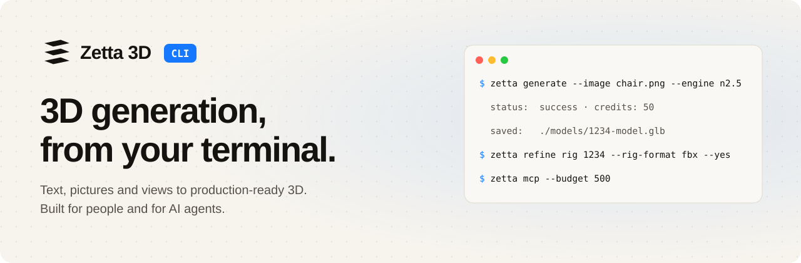

<p align="center">
  <picture>
    <source media="(prefers-color-scheme: dark)" srcset="docs/assets/banner-dark.svg">
    
  </picture>
</p>

<p align="center">
  <a href="https://github.com/ig-shadow-walker/Zetta3D-CLI/releases/latest"></a>
  <a href="#install"></a>
  <a href="#install"></a>
  <a href="#use-it-from-ai-agents"></a>
  <a href="#use-it-from-ai-agents"></a>
</p>

<p align="center">
  <a href="#install"><b>Install</b></a> ·
  <a href="docs/getting-started.md"><b>Getting started</b></a> ·
  <a href="#features"><b>Features</b></a> ·
  <a href="docs/ai-agents.md"><b>AI agents &amp; MCP</b></a> ·
  <a href="docs/COMMANDS.md"><b>Commands</b></a> ·
  <a href="https://zetta3d.ai"><b>zetta3d.ai</b></a>
</p>

<br>

**`zetta` is the command-line interface for [Zetta 3D](https://zetta3d.ai).** Turn text, a picture or a few views into a production-ready 3D model, refine it, and download it, all from your terminal. Everything you can do on the Zetta 3D website, you can script, automate, or hand to an AI agent.

```bash
# Install, then sign in with your browser
curl -fsSL https://github.com/ig-shadow-walker/Zetta3D-CLI/releases/latest/download/install.sh | sh

# Turn a picture into a 3D model
zetta generate --image chair.png --max-credits 100 --out ./models
```

<p align="center">
  
</p>

## Highlights

- **One line to install.** A single self-contained program for macOS, Linux and Windows. No Node, Python or package manager needed.
- **Your whole account.** Generation, refining, pictures, splat worlds, pipelines, your library, credits and billing.
- **Built for AI agents.** JSON output, stable exit codes, a built-in MCP server, and an agent skill for Claude Code, Codex and Cursor that installs itself.
- **Nothing costs credits by accident.** Every paid command shows its price first; `--dry-run`, `--max-credits` and `--yes` keep you in control.
- **Always up to date.** `zetta` tells you when a new version is out and updates itself in seconds.

## Contents

- [Install](#install)
- [Sign in](#sign-in)
- [Quick start](#quick-start)
- [Features](#features)
- [How it works](#how-it-works)
- [Use it from AI agents](#use-it-from-ai-agents)
- [Updating](#updating)
- [Configuration](#configuration)
- [Uninstalling](#uninstalling)
- [Documentation](#documentation)
- [Development](#development)
- [Support and security](#support-and-security)

## Install

**macOS and Linux**

```bash
curl -fsSL https://github.com/ig-shadow-walker/Zetta3D-CLI/releases/latest/download/install.sh | sh
```

**Windows (PowerShell)**

```powershell
irm https://github.com/ig-shadow-walker/Zetta3D-CLI/releases/latest/download/install.ps1 | iex
```

The installer:
1. picks the build for your computer: macOS (Apple Silicon or Intel), Linux (x64) or Windows (x64);
2. checks the download against its published SHA-256 checksum;
3. installs `zetta` into `~/.zetta/bin` (Windows: `%LOCALAPPDATA%\zetta\bin`), without sudo or admin rights, and adds it to your `PATH`;
4. sets up the Zetta 3D skill for any AI coding agent it finds (Claude Code, Codex, Cursor);
5. opens your browser to sign in, so `zetta` is connected to your account straight away.

Then check it:

```bash
zetta --version
zetta doctor          # checks the install, the sign-in, the connection and the agent skill
```

<details>
<summary><b>Download a build yourself</b></summary>

<br>

Every [release](https://github.com/ig-shadow-walker/Zetta3D-CLI/releases/latest) has one file per platform. Download yours, make it executable, and put it on your `PATH`:

| Platform | File |
|---|---|
| macOS (Apple Silicon and Intel) | `zetta-macos` |
| Linux (x64) | `zetta-linux-x64` |
| Windows (x64; Windows on Arm runs it too) | `zetta-windows-x64.exe` |

```bash
curl -fLo zetta https://github.com/ig-shadow-walker/Zetta3D-CLI/releases/latest/download/zetta-macos
chmod +x zetta && mv zetta ~/.local/bin/
```

Each release lists the checksum of every file in `SHA256SUMS` (`shasum -a 256 -c SHA256SUMS --ignore-missing`). On macOS, a file downloaded with a browser is quarantined; clear that with `xattr -d com.apple.quarantine zetta`, or use the one-line installer, which avoids it.

</details>

<details>
<summary><b>A specific version, a custom folder, CI</b></summary>

<br>

```bash
# A specific version
curl -fsSL https://github.com/ig-shadow-walker/Zetta3D-CLI/releases/latest/download/install.sh | ZETTA_VERSION=0.2.0 sh

# Another folder
curl -fsSL https://github.com/ig-shadow-walker/Zetta3D-CLI/releases/latest/download/install.sh | ZETTA_INSTALL_DIR=/usr/local/bin sh

# CI: no sign-in, no agent skill
curl -fsSL https://github.com/ig-shadow-walker/Zetta3D-CLI/releases/latest/download/install.sh | ZETTA_NO_LOGIN=1 ZETTA_NO_SKILL=1 sh
```

The installer never starts the browser sign-in without a person at the terminal, so it is safe in CI and Docker. See [docs/installation.md](docs/installation.md) for everything else.

</details>

## Sign in

```bash
zetta auth login            # opens zetta3d.ai in your browser; click Connect
```

| Where you are | How to sign in |
|---|---|
| A computer with a browser | `zetta auth login` (the installer starts it for you) |
| SSH, a container, a server, CI, scripts | An API key: create one on zetta3d.ai (Profile › API keys) or with `zetta apikey create <name>`, then set `ZETTA_API_KEY` |

Your sign-in is kept in the system keychain (macOS Keychain, Windows Credential Manager or libsecret). `zetta auth status` shows who you are signed in as. API keys (`zk_live_…`) last until you revoke them with `zetta apikey revoke <id>`, and can't manage keys, billing or the account. More in [docs/authentication.md](docs/authentication.md).

## Quick start

```bash
# What do I have?
zetta account show                        # plan, trial and balances
zetta catalog entitlements                # what your plan allows

# A model from a picture: price it first, then make it and download it
zetta generate --image chair.png --dry-run
zetta generate --image chair.png --max-credits 100 --out ./models

# A model from text
zetta generate -p "a stylised wooden treasure chest" --quality lowpoly --yes

# Finish it: retopology, then a rig
zetta refine retopo 1234 --faces 5000 --yes
zetta refine rig 1235 --rig-type biped --rig-format fbx --yes --out ./models

# Convert locally, for free
zetta asset export 1235 --format stl --out ./print
```

The step-by-step walkthrough is in [docs/getting-started.md](docs/getting-started.md).

## Features

| | What you can do | Commands |
|---|---|---|
| **Generate** | 3D models from text, one picture, or several views (front, back, sides); parts, quad meshes, detail levels; Gaussian-splat objects and worlds | `generate`, `splat` |
| **Refine** | Retopology to a polygon budget, segmentation into parts, Smart UV, AI texturing, auto-rigging, format conversion | `refine retopo`, `segment`, `uv`, `texture`, `rig`, `convert` |
| **Pictures** | Generate, edit and combine pictures (ready for 3D if you like), remove backgrounds, make PBR texture maps | `image`, `asset texture-map` |
| **Pipelines** | Multi-step recipes (picture → model → retopology → rig), the same as in the web editor; validate, price, and run them over a whole folder | `pipeline`, `run` |
| **Library** | List, search, wait for, download, share, tag, import and delete your models; export to OBJ, FBX or STL locally | `asset` |
| **Account** | Credits, usage history, plans, checkout, trial codes, API keys, connected apps | `account`, `billing`, `apikey` |
| **Agents** | MCP server, agent skill, one-command setup for Claude Code, Claude Desktop, Codex and Cursor | `mcp`, `skill`, `setup` |

Results come back as GLB, FBX, OBJ, STL, USDZ, glTF or PLY. Every command and flag is in [docs/COMMANDS.md](docs/COMMANDS.md).

## How it works

<p align="center">
  <picture>
    <source media="(prefers-color-scheme: dark)" srcset="docs/assets/how-it-works-dark.svg">
    
  </picture>
</p>

- **Assets.** Every model you make, refine or import is an *asset* in your Zetta 3D library, with a numeric id, a status, and its files.
- **Credits and the spend guard.** Paid commands always check the price first. `--dry-run` shows it and spends nothing; `--max-credits N` spends only up to N; `--yes` spends without asking. In a terminal without either, you are asked. In a script, the command refuses rather than spend. Failed jobs are refunded automatically.
- **Jobs run on Zetta 3D.** In a terminal, `zetta` waits for each job and downloads the result into the current folder (or `--out <folder>`). Scripts and agents get the asset id straight away, and can pick it up later with `zetta asset wait <id>`.
- **Inputs.** A picture can be a local file, an `https://` URL, or `image:<id>` from your image library. A model can be an asset id, a local `.glb`, or a URL. Local files are uploaded for you.

## Use it from AI agents

`zetta` is designed to be driven by agents such as Claude Code, Codex, Cursor and CI scripts.

```bash
zetta setup claude-code --budget 500      # skill + MCP server for Claude Code, capped at 500 credits a session
zetta setup claude-desktop                # MCP server for Claude Desktop
zetta setup cursor                        # skill + MCP server for Cursor
zetta setup codex                         # skill + MCP server for Codex
zetta setup agents-md                     # a guide in ./AGENTS.md for any other agent
```

- **Predictable output.** JSON on stdout whenever it isn't a terminal; diagnostics on stderr. Every error has the same shape, `{"error":{"code","message","details","hint","exitCode"}}`, and the `hint` names the next command to run.
- **Exit codes to branch on.** 0 ok · 2 fix the input · 3 sign in · 4 plan doesn't allow it · 5 credits or spend limit · 6 not found · 7 conflict · 8 rate limited · 9 job failed · 10 still running · 11 network or server.
- **Self-describing.** `zetta commands --json` lists every command and flag; `zetta schema <command>` gives its JSON Schema.
- **Safe retries.** `--idempotency-key <key>` makes a retry free of double charges.
- **MCP.** `zetta mcp` serves the commands as MCP tools with the same checks. `--budget N` caps what a session may spend; `--read-only` offers only tools that change nothing.
- **The skill keeps itself current.** It is installed where Claude Code, Codex and Cursor look, and updated with every new `zetta`. `zetta skill uninstall` removes it.

The full agent guide is printed by `zetta guide`, and lives in [docs/ai-agents.md](docs/ai-agents.md).

## Updating

When a new version is out, `zetta` asks once, after a command:

```text
zetta 0.3.0 is out (you have 0.2.0). Update now? [Y/n]
```

Press Enter, and it downloads the new version, checks its checksum, test-runs it and swaps it in. Or update whenever you like:

```bash
zetta upgrade               # to the latest version
zetta upgrade --check       # is there a newer one?
zetta upgrade --to 0.2.0    # a specific version, newer or older
```

Agents are told about new versions through `zetta upgrade --check` and the MCP server; scripts and CI are never prompted. `ZETTA_NO_UPDATE_CHECK=1` turns the check off.

## Configuration

`zetta` works with no configuration. Some useful settings:

```bash
zetta config list
zetta config set spend.maxPerCommand 200     # never spend more than 200 credits in one command
zetta config set download.dir models         # collect downloads in ./models
zetta config set download.auto false         # don't download finished jobs automatically
zetta config set output json                 # always print JSON
```

Environment variables include `ZETTA_API_KEY`, `ZETTA_PROFILE`, `ZETTA_OUTPUT`, `ZETTA_NON_INTERACTIVE=1`, `ZETTA_NO_UPDATE_CHECK=1` and `NO_COLOR`. See [docs/configuration.md](docs/configuration.md).

## Uninstalling

```bash
zetta auth logout                     # forget the sign-in
zetta skill uninstall                 # remove the agent skill
rm -rf ~/.zetta ~/.config/zetta3d     # remove zetta and its settings
```

Then delete the `# zetta` line the installer added to your shell's startup file. On Windows, delete `%LOCALAPPDATA%\zetta` and `%APPDATA%\zetta3d`, and remove zetta from your user `Path`. Details in [docs/installation.md](docs/installation.md#uninstalling).

## Documentation

| Guide | What is in it |
|---|---|
| [Installation](docs/installation.md) | Every install method, updating, uninstalling, CI, supported systems |
| [Getting started](docs/getting-started.md) | From sign-in to a downloaded model, step by step |
| [Authentication](docs/authentication.md) | Browser sign-in, API keys, the keychain, profiles, CI; plans, trials and billing |
| [Generating models](docs/generating.md) | Text, picture and multi-view to 3D, every option, splat worlds |
| [Refining models](docs/refining.md) | Retopology, segmentation, UVs, texturing, rigging, conversion, local export |
| [Your library](docs/library.md) | Listing, waiting, downloading, sharing, tagging, importing, texture maps, deleting |
| [Images](docs/images.md) | Generating, editing and combining pictures; removing backgrounds |
| [Pipelines](docs/pipelines.md) | Recipes in YAML, validating, pricing, running and batching |
| [AI agents and MCP](docs/ai-agents.md) | The output contract, the spend guard, MCP, skills, setup per tool |
| [Configuration](docs/configuration.md) | Settings, profiles, environment variables, output formats |
| [Troubleshooting](docs/troubleshooting.md) | Every error code and what to do about it |
| [Command reference](docs/COMMANDS.md) | Every command and flag, generated from the code |

## Development

```bash
bun install
bun run zetta -- --help     # run from source
bun run check               # typecheck, tests, lint
bun run build               # a binary for this computer, in release/<platform>/
bun run release             # check, build every platform, tag and publish a GitHub release
```

Architecture and tests are in [docs/development.md](docs/development.md); releases in [docs/releasing.md](docs/releasing.md).

## Support and security

- **Questions and bugs:** [open an issue](https://github.com/ig-shadow-walker/Zetta3D-CLI/issues). For your account, plan or billing, contact us through [zetta3d.ai](https://zetta3d.ai).
- **Security:** please don't open a public issue. Report it privately through [GitHub's security advisories](https://github.com/ig-shadow-walker/Zetta3D-CLI/security/advisories/new).
